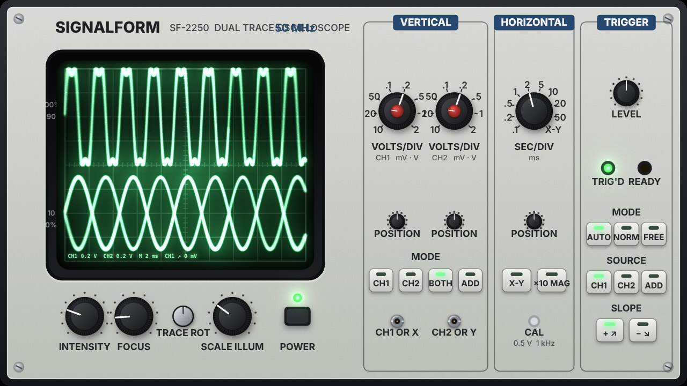
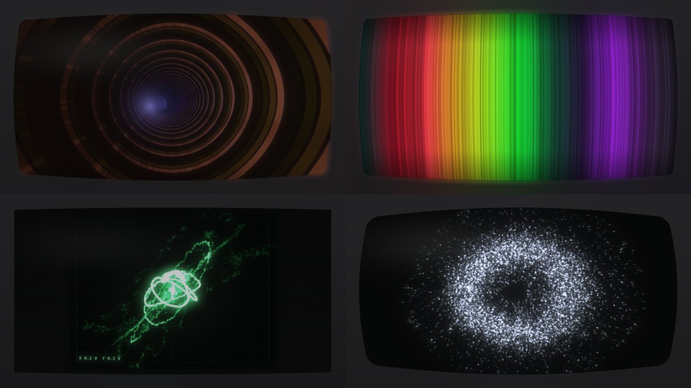
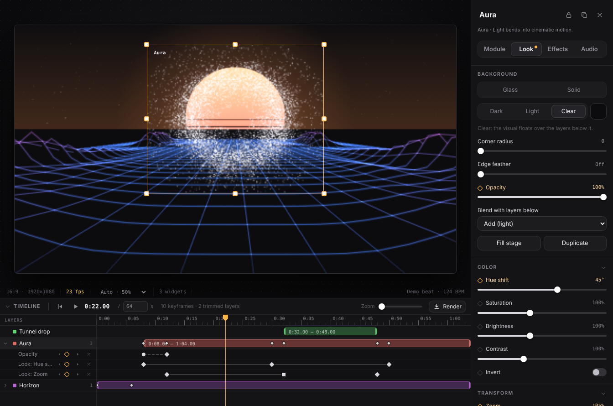

<p align="center">
  
</p>

<p align="center">
  <a href="https://github.com/Kuzuw/signalform/releases/latest"></a>
  <a href="https://github.com/Kuzuw/signalform/releases"></a>
  <a href="https://github.com/Kuzuw/signalform/actions/workflows/build.yml"></a>
  <a href="https://github.com/Kuzuw/signalform/actions/workflows/ci.yml"></a>
  
  <a href="LICENSE"></a>
</p>

<p align="center">
  <b>Turn any sound into live visuals.</b> Twenty audio-reactive modules you can layer, resize and blend<br>
  into one composition, animate it on a timeline, then record it, render it to MP4 or perform it full screen.<br>
  Also available as effect plug-ins for <a href="https://github.com/storytold/effectcraft">EffectCraft</a>.
</p>

<p align="center">
  <a href="https://github.com/Kuzuw/signalform/releases/latest"><b>Download for Windows</b></a> ·
  <a href="docs/MODULES.md">Module reference</a> ·
  <a href="#quick-start">Quick start</a> ·
  <a href="#build-from-source">Build from source</a> ·
  <a href="CHANGELOG.md">Changelog</a>
</p>

<p align="center">
  
</p>

## Contents

- [Highlights](#highlights)
- [Showcase](#showcase)
- [Modules](#modules)
- [Download and install](#download-and-install)
- [Quick start](#quick-start)
- [Keyboard and mouse](#keyboard-and-mouse)
- [Audio sources](#audio-sources)
- [Timeline](#timeline)
- [Recording and export](#recording-and-export)
- [Signalform for EffectCraft](#signalform-for-effectcraft)
- [Live Output](#live-output)
- [FAQ](#faq)
- [Build from source](#build-from-source)
- [Architecture](#architecture)
- [Roadmap](#roadmap)
- [Contributing](#contributing)
- [License](#license)

## Highlights


| Feature | What you get |
|---|---|
| **20 visual modules** | From phosphor oscilloscopes and lightning to raymarched ferrofluid, a tunnel flight and a 100,000-point creature that can spell words. GPU-accelerated where it matters. |
| **Free composition** | Every module is a widget. Move, resize, layer, blend, group, align, lock, hide or duplicate it. Cards can be glass, solid, dark, light or clear, with rounded corners and feathered edges. |
| **Deep control** | Each widget has three tabs: **Module** (its own settings, eight color palettes, presets, Randomize), **Look** (color, transform, mirror and kaleidoscope, glow, trails, pixelate, vignette) and **Audio** (reactivity, which part of the mix it hears, smoothing, hit strength, speed). |
| **Effect rack** | Chain GPU effects on any widget, or on the whole stage: glow, light streaks, blur, motion and zoom blur, colour grade, gradient map, halftone, pixelate, posterize, edge glow, kaleidoscope, mirror, warp, RGB split, film grain, CRT screen, glitch, feedback echo, strobe and more. Any effect can follow the music. |
| **CRT simulation** | The CRT screen effect simulates a tube from the signal up: RGB, S-Video, composite (with real NTSC dot crawl and colour bleed) or an aerial; a round beam spot that grows with brightness; aperture grille, slot or shadow mask; a sagging power supply, overscan and geometry errors; halation, curved glass with dust and smudges, and a bezel that reflects the picture. Six monitors to start from, and it degausses on drops. |
| **Real-life oscilloscope** | The oscilloscope simulates the beam, the phosphor and the time base, and can show the whole instrument: a dual-trace analog scope whose knobs, buttons and lamps follow its real settings. |
| **Music-aware analysis** | Bass, mid and high levels; kick, snare and hi-hat detection on the audio thread (small trained classifiers tell kicks and snares apart from bass notes); pitch; and build-up and drop detection, shared by every module. |
| **Any sound in** | What your PC is playing, a microphone or audio interface, a virtual cable, a track file, or the built-in demo beat. |
| **Timeline** | Keyframe any setting with the ◆ beside it (linear, eased or held), set when each layer starts and stops, and scrub the track with the playhead. Renders follow the timeline. |
| **Video out** | Render a track or the timeline to MP4 with its audio, or record live takes of the whole stage, a group or a single widget. |
| **EffectCraft plug-ins** | CRT Screen, Tunnel, Cells, Ferro, Horizon and Aura as WebAssembly effect plug-ins for [EffectCraft](https://github.com/storytold/effectcraft), plus a script export that brings a track's beats, bands, builds and drops into EffectCraft or After Effects as keyframes. |
| **Scenes and presets** | Save whole layouts as scenes (and share them as `.sfscene` files), or save module settings as presets. Eleven starter scenes are included. |
| **Free and open source** | MIT licensed. No account, no license key, no telemetry. |

## Showcase

<table>
<tr>
<td width="58%"></td>
<td><b>A real oscilloscope</b><br><br>Every audio sample drives a simulated electron beam: slow parts burn bright, fast jumps fade, and the phosphor glows on with its own afterglow. Switch the look to <i>Real-life oscilloscope</i> and the whole instrument appears around the tube. Turn the time base in the panel and the SEC/DIV knob turns with it; the TRIG'D lamp flashes as the sweep triggers.</td>
</tr>
<tr>
<td></td>
<td><b>A CRT from the signal up</b><br><br>Add <i>CRT screen</i> from the effect rack to any layer or to the whole stage. The picture is encoded and decoded as a real video signal, drawn by a beam that blooms on bright lines, filtered through a phosphor mask and shown through curved, slightly dusty glass. Pick a living-room TV, an arcade monitor, a studio monitor, a computer monitor, a black-and-white set or an old TV on an aerial.</td>
</tr>
</table>

## Modules

<p align="center"></p>

| Module | What it does | Reacts to |
|---|---|---|
| **ASCII** | Bold glyphs (x, %, X, &, #, @) rising out of the dark like a terminal, or blocks, dots, binary, hex, katakana or your own text. | Columns follow frequencies; bass punches the density; hats sparkle. |
| **Aura** | A breathing ring of thousands of shimmering specks, as a ring, two rings, a disc or a turning sphere. Light blooms with streaks and diffraction spikes are a second look. | The rim swells where its slice of the spectrum is loud; kicks pulse it, drops blow it wide. |
| **Ferro** | Black magnetic fluid on white: a chain of glossy beads that merge and part, small buds and thorns, and a spray of droplets around it. | Kicks fuse the beads, hits fling droplets that the magnet pulls back, heavy hits and drops snap it into one round drop. |
| **Flow Field** | A grid of points carried by a slowly shearing flow field, or thousands of particles streaming through curl-noise, vortex, wave, radial or crosshatch fields. | Bass pushes the field; kicks burst it outwards; highs add turbulence. |
| **Fractal** | A recursive network: clusters of linked points inside clusters, filling the frame. Julia, Kali and folded-geometry fractals are also available. | Hits light up links, kicks make it breathe, drops and heavy hits rewire it. |
| **Grain** | Dust strung along slow, wavy bands that thicken, thin out and drift. A dense grain texture is a second look. | Bass sways the bands, kicks scatter them, hats make specks glint. |
| **Lissajous** | Dozens of fine translucent ribbons tracing a tumbling harmonic knot in 3D. | Pitch sets the ratios, mids deform the knot, or the stereo X/Y signal draws the figure. |
| **Oscilloscope** | A real analog oscilloscope simulated from the electron beam up: X/Y, a triggered Y/T time base with dual trace, P31/P1/P7/P4/P11/P3 phosphors with true afterglow, a bezelled tube with corner defocus, phosphor grain and halation, graticule and readout. The beam can also draw a shape or **a picture you load**. | Every sample of the stereo signal; a slow beam burns bright, a fast one fades, like a CRT. |
| **Spectre** | The spectrum as glowing emission lines in prism colors, or as bands, layers, a flowing spectrogram or a ring. | Every band lights its own lines, equalized so quiet regions still glow. |
| **Trace** | The live signal at high gain, like a pen recorder pushed into the rails, or up to 12 lines as an open line, a loop or a spiral. | The raw waveform; or the spectrum bends the lines and hits send ripples. |
| **Waveform** | A solid white mass of the music scrolling past, jagged with transients, or layered rings, contours and mirrored layers. | Peaks of each slice shape the edge; kicks thicken it. |
| **Oscillon** | A phosphor beam sweeps a translucent shell (cushion, pebble, peanut, trefoil, apple, ring, clover or orb), with bright caustic folds. Or load a picture and the beam draws it as a swaying, swelling sheet of light. | Snaps to a new form on heavy hits and drops, every sound leaves a swelling on the surface, squeezes on a build and throws itself open on the drop. |
| **Stroke** | A pen of light on a long exposure. Slow strokes burn thick, fast ones thin to a wire. | Follows the melody; hits break the line into flaring corners. |
| **Discharge** | Lightning on a photographic plate. | Kicks tear long channels, snares throw arcs, hats crackle; it holds back through a build and breaks loose on the drop. |
| **Familiar** | Up to 100,000 points of light that rest as one creature, or become a word you type. | Breathes in silence, scatters on hits and gathers back. |
| **Tunnel** | An endless flight through a curving tunnel of light rings, wire grid, light panels or warp streaks, round or polygonal. | Each ring is born at the far end with the energy of that moment, so every hit flies towards you; kicks surge forward, drops hit hyperspeed. |
| **Horizon** | A wireframe landscape grown from the spectrum, rolling towards a setting sun, a moon or a glow. | Every row of terrain is the spectrum when it was born; kicks raise ridges, drops flash the sky. |
| **Strings** | Strings laid out horizontally, vertically, as a harp or across a circle, drawn with a shutter blur like a real instrument. | Hits pluck the strings of their register, each string is bowed by its own band, builds raise the tension. |
| **Halo** | Rings of light thrown from the center, as circles, polygons, stars or flowers. | Each hit throws a ring colored by kick, snare or hi-hat, shaped by the spectrum or waveform of that instant. |
| **Cells** | A moving Voronoi tissue in glass, organic, crystal or stained-glass styles. | Every cell listens to its own slice of the spectrum; hits make the tissue flinch and builds shrink it. |

Every control of every module, with ranges and defaults, is listed in the **[module reference](docs/MODULES.md)**.

## Download and install

1. Download **`Signalform-Setup-x.y.z.exe`** from the [latest release](https://github.com/Kuzuw/signalform/releases/latest).
2. Run it and pick an install folder.
3. The installer isn't code-signed yet, so Windows SmartScreen may warn you. Choose **More info** → **Run anyway**. The installer is built from this repository by [GitHub Actions](.github/workflows/build.yml), and you can [build it yourself](#build-from-source) instead.

**Requirements**

| | Minimum | Recommended |
|---|---|---|
| OS | Windows 10, 64-bit | Windows 11, 64-bit |
| GPU | Any GPU with WebGL 2 | A dedicated GPU for big stages or many particles |

## Quick start

1. **Pick a sound.** Open the **Audio source** card at the top left and choose **Connect** to capture what your PC is playing, an input, a track file, or the demo beat.
2. **Add modules.** Click a tile in the library, or drag it onto the stage. Add as many as you like.
3. **Compose.** Drag widgets to move them and pull their edges to resize. Use the inspector's **Background** to make a card glass, solid or clear, and **Blend** to mix it with the layers below.
4. **Shape each widget.** Change its settings in **Module**, its picture in **Look** and how it hears the music in **Audio**. **Randomize** rolls a new look; double-click any slider to reset it.
5. **Save** the layout with **Scenes** (Ctrl+S), then **Record**, export a video, or press **F** to perform full screen.

> [!TIP]
> Not sure where to start? Open **Scenes** and load a starter: *Phosphor Room*, *Three Cards*, *Storm Shell*, *Long Exposure*, *Magnetic*, *Paper*, *Vertical Story*, *Hyperspace*, *Sunset Run* or *Stained Glass*.

## Keyboard and mouse

| Action | Shortcut |
|---|---|
| Play / pause the track or demo beat | <kbd>Space</kbd> |
| Perform mode (visuals only) | <kbd>F</kbd>, <kbd>Esc</kbd> to leave |
| Scenes | <kbd>Ctrl</kbd>+<kbd>S</kbd> |
| Select all widgets | <kbd>Ctrl</kbd>+<kbd>A</kbd> |
| Select several | <kbd>Shift</kbd>+click |
| Group / ungroup | <kbd>Ctrl</kbd>+<kbd>G</kbd> / <kbd>Ctrl</kbd>+<kbd>Shift</kbd>+<kbd>G</kbd> |
| Pick one widget inside a group | Double-click |
| Duplicate / delete | <kbd>Ctrl</kbd>+<kbd>D</kbd> / <kbd>Delete</kbd> |
| Bring forward / send backward | <kbd>]</kbd> / <kbd>[</kbd> |
| Nudge (bigger steps) | Arrow keys (with <kbd>Shift</kbd>) |
| Resize keeping the shape / without snapping | Drag a corner with <kbd>Shift</kbd> / with <kbd>Alt</kbd> |
| Reset a slider / type an exact value | Double-click the slider / click its number |
| Widget menu | Right-click a widget |
| Show or hide the timeline | <kbd>Ctrl</kbd>+<kbd>T</kbd> |
| Playhead to the start / end | <kbd>Home</kbd> / <kbd>End</kbd> |
| Keyframe a setting | Click the ◆ beside it |
| Change a key's easing / delete it | Right-click the key / click it and press <kbd>Delete</kbd> |
| Move a key or a layer bar without snapping | Drag it with <kbd>Alt</kbd> |
| Zoom / scroll the timeline | <kbd>Ctrl</kbd>+scroll / <kbd>Shift</kbd>+scroll |

## Audio sources

| Source | Use it for |
|---|---|
| **Connect** (system audio) | Whatever your PC is playing: Spotify, YouTube, a DAW, a game. Captures the default output device. |
| **Inputs** | A microphone, a mixer or an audio interface. |
| **Virtual cables** | [VB-Cable](https://vb-audio.com/Cable/) or [Voicemeeter](https://vb-audio.com/Voicemeeter/) to route one app's audio only. |
| **Track** | An audio file. Loop it, monitor it, scrub it and export a video from it. |
| **Demo beat** | A built-in 124 BPM loop with builds and drops, for trying things out without music. |

## Timeline



The timeline sits under the stage (<kbd>Ctrl</kbd>+<kbd>T</kbd> shows or hides it, and its top edge drags to resize it).

- **The playhead.** With a track loaded, the playhead *is* the track's position: play, pause and scrub it from the ruler, and the track's waveform is drawn along the top. Without a track, the timeline has its own clock and a length you set (30 seconds to start), and the music comes from whatever source is on, live input included.
- **Keyframes.** Every setting a widget has, in Module, Look and Audio, plus its opacity, has a **◆** beside its name. Click it to add a key at the playhead; once a setting has keys, changing it adds or updates the key where the playhead is, the same as in a video editor. Numbers and colours travel smoothly between keys; choices and switches change at the key. Right-click a key for **Linear**, **Ease in and out** or **Hold**; drag keys along their row; click one and press <kbd>Delete</kbd> to remove it. Keys snap to the playhead and to other keys.
- **In and out points.** Each layer has a bar. Drag its ends to set when it appears and disappears, or drag the bar to move it; double-click it to make it play the whole time. A layer outside its bar is not drawn at all, so it costs nothing.
- **Everything is saved with the scene**, and the audio still drives every widget as usual: keyframes set *what* the visuals are, the music moves them.

## Recording and export

- **Export video from this track** plays a loaded track from the start and renders the stage to an MP4 (H.264 + AAC) with the track's audio, following the timeline. It runs in real time, so it takes as long as the track.
- **Render** (in the timeline, or *File ▸ Render to Video…*, <kbd>Ctrl</kbd>+<kbd>R</kbd>) renders the timeline from the start for its length when no track is loaded, with or without the audio of the current source.
- **Record** captures a live take of whatever is playing. The **Record Widget** dialog lets you record the whole stage, a group or one widget, at 720p, 1080p, 1440p or 4K and 30 or 60 fps, with or without audio.
- When a take ends, you choose where to save it (your Videos folder by default). Videos are saved as MP4; the bundled ffmpeg converts them when needed.

## Signalform for EffectCraft

Signalform also comes as a pack of effect plug-ins for **[EffectCraft](https://github.com/storytold/effectcraft)**, the free, open-source motion graphics and compositing app by the ArtCraft Team and the EffectCraft contributors. Put Signalform's looks on layers in an EffectCraft composition, keyframe them, mix them with everything else EffectCraft does, and render.

| Effect | What it does |
|---|---|
| **Signalform CRT Screen** | Shows any layer on a cathode-ray tube: RGB, S-Video or composite NTSC signal, scan lines that widen on bright parts, aperture grille, slot or shadow mask, curved glass, halation and a bezel. |
| **Signalform Tunnel** | A flight down an endless tunnel of light rings, grid, panels or warp streaks. |
| **Signalform Cells** | Frosted-glass, organic, crystal or stained-glass cells, each lit by its slice of the spectrum. |
| **Signalform Ferro** | Black magnetic fluid that spikes, pumps and throws droplets, with the **REACTIVE!!!** switch. |
| **Signalform Horizon** | A neon landscape rolling towards a striped setting sun. |
| **Signalform Aura** | A breathing ring of thousands of shimmering specks. |

**Install:** download `Signalform-for-EffectCraft-x.y.z.zip` from the [latest release](https://github.com/Kuzuw/signalform/releases/latest) and copy the `.wasm` files into EffectCraft's `Plug-ins` folder (`%APPDATA%\EffectCraft\Plug-ins` on Windows), or load one with *Effect ▸ Load Effect Plug-in…*.

**Make them follow the music:** open the track in Signalform and click **Export for EffectCraft** in the track card. Signalform analyses the whole track offline (much faster than playing it) and saves a script; run it in EffectCraft with your composition open (*File ▸ Scripts ▸ Run Script File…*). It adds a **Signalform Audio** null layer with keyframed Level, Bass, Mids, Highs, Kick, Snare, Hi-hat, Build and Drop sliders and links every Signalform effect in the comp to them. The **Signalform Audio Link** panel in the zip links effects you add later, or works from EffectCraft's own *Convert Audio to Keyframes*. The script uses the After Effects object model, so it runs in After Effects too.

The plug-ins are small C files compiled to WebAssembly against EffectCraft's [plug-in API](https://github.com/storytold/effectcraft/blob/main/docs/plugins.md); CI renders every one of them in EffectCraft's own plug-in host. Details, previews and build steps: **[plugins/effectcraft](plugins/effectcraft/README.md)**.

> EffectCraft and ArtCraft are the names and trademarks of their owners. Signalform for EffectCraft is an independent plug-in pack, not made or endorsed by them.

## Live Output

**Live Output** can send the stage, a group or one widget as a live video source over **Spout** and **NDI**, for Resolume, OBS, TouchDesigner and other VJ tools.

> [!NOTE]
> Spout and NDI depend on native add-ons that the release build tries to compile. In the current release they are not bundled, so the dialog shows them as unavailable along with the reason. Until then, capture the Signalform window in OBS (Window Capture) or use Perform mode on a second screen. If you can help package the add-ons, see [Contributing](#contributing) and `main/outputs/`.

## FAQ

<details>
<summary><b>Connect doesn't hear anything.</b></summary>

Connect captures the **default** output device. Check that the music plays through that device (Windows Settings → System → Sound → Output), and that it isn't muted. If your audio goes to a device that isn't the default, choose it as an input via a virtual cable instead.
</details>

<details>
<summary><b>The visuals stutter or the frame rate is low.</b></summary>

Leave **render quality** (bottom of the stage) on *Auto*, which lowers the resolution while the frame rate is low, or pick *Balanced* or *Fast*. Lower the particle or point count of Flow Field, Familiar and Oscillon, turn off **Smooth edges** in Fractal, use fewer widgets, or pick a smaller stage aspect. On laptops, make sure Signalform runs on the dedicated GPU (Windows Settings → System → Display → Graphics).
</details>

<details>
<summary><b>Can I use it with my DAW?</b></summary>

Yes. Play from the DAW and use **Connect**, or route the DAW's output to a virtual cable and pick that cable as the input.
</details>

<details>
<summary><b>Is there a macOS or Linux version?</b></summary>

Not at the moment. Signalform is built and tested for Windows. The code is plain Electron, so ports are possible, and contributions are welcome.
</details>

<details>
<summary><b>Where are my scenes and presets stored?</b></summary>

In your Windows user profile (`%APPDATA%\Signalform`). Scenes can also be exported and imported as `.sfscene` files from the Scenes dialog.
</details>

<details>
<summary><b>Does it collect any data?</b></summary>

No. Signalform has no accounts, analytics or telemetry, and it doesn't connect to the internet.
</details>

## Build from source

You need [Node.js 20+](https://nodejs.org) and Git on Windows.

```bash
git clone https://github.com/Kuzuw/signalform.git
cd signalform
npm install
npm start          # run the app
npm run dev        # run with DevTools
npm run dist       # build dist/Signalform-Setup-x.y.z.exe
npm test           # source and settings checks
```

### Tests

Every push and pull request runs [`ci.yml`](.github/workflows/ci.yml): the source and settings checks (`npm test`), a check that the [module reference](docs/MODULES.md) is up to date, beat detection scored on 24 synthetic mixes (`npm run test:onsets`, kick and snare F1 must stay at 80% or more), the whole interface and the timeline clicked through in headless Chromium (`npm run test:ui`, `npm run test:timeline`), the EffectCraft scripts run against a model of the scripting API, and the EffectCraft plug-ins built, validated and rendered in EffectCraft's own WebAssembly host. The screenshots are kept with each run.

### Releases

Releases are fully automated by [`.github/workflows/build.yml`](.github/workflows/build.yml):

1. Bump `version` in `package.json` and add an entry to [`CHANGELOG.md`](CHANGELOG.md).
2. Push to `main`.
3. About ten minutes later the release `v<version>` appears with the installer and the EffectCraft plug-in pack. The workflow creates the tag.

Pushes that keep the same version rebuild that release's installer; documentation-only changes don't trigger a build. To sign the installer, add a code-signing certificate as the secrets `WIN_CERT_PFX_BASE64` and `WIN_CERT_PASSWORD`.

## Architecture

```
main/                 Electron main process
  main.js             window, menus, app:// protocol, recording files, ffmpeg transcode
  store.js            scenes, presets and settings on disk
  preload.js          the small, typed bridge the UI talks to (window.sf)
  outputs/            Spout and NDI adapters
renderer/             the interface (plain ES modules, no build step)
  audio.js            sources and analysis: levels, pitch, build and drop
  onset-core.js       kick / snare / hat detection, run on the audio thread by onset-worklet.js
  kick-net.js         the kick classifier's weights (scripts/train-kick.mjs)
  snare-net.js        the snare classifier's weights (TARGET=snare scripts/train-kick.mjs)
  stage.js            widgets, layout, layering, groups and the compositor
  timeline.js         keyframes, in and out points, the playhead and the timeline panel
  effectcraft.js      the track analysis as an EffectCraft / After Effects script
  fx.js               per-widget Look and Audio controls
  rack.js             the effect rack: effects and the shared GPU engine that runs them
  crt.js              the CRT screen effect: signal encode/decode, beam, mask, glass
  inspector.js        the Module / Look / Audio panel, generated from parameter schemas
  modules/            the 20 visual modules (WebGL 2 for Ferro, Tunnel, Cells, Oscilloscope and the shader looks of Aura and Fractal; Canvas 2D for the rest)
    scope-panel.js    the real-life oscilloscope's front panel
plugins/effectcraft/  Signalform for EffectCraft: the WebAssembly effect plug-ins (C), their tests and the Audio Link panel
docs/                 module reference and README images
scripts/              checks (check.mjs), generators for docs/MODULES.md and the README images
test/                 headless interface, module and render tests
```

Each frame, `audio.js` produces one analysis frame and `timeline.js` sets the animated settings for the playhead's time. Every widget reshapes it through its **Audio** settings, its module draws into an offscreen canvas, the **Look** pass applies color, transform and effects, and the compositor stacks the widgets with their backgrounds and blend modes.

## Roadmap

- [ ] Bundle the Spout and NDI add-ons in the release build
- [ ] Code-signed installer
- [ ] MIDI and OSC control of any parameter
- [ ] Automatic updates
- [ ] More modules

Ideas and votes are welcome in [Issues](https://github.com/Kuzuw/signalform/issues).

## Contributing

Bug reports, ideas and pull requests are welcome. A new module is a single file in `renderer/modules/`: its settings panel is generated from its parameter list. See **[CONTRIBUTING.md](CONTRIBUTING.md)** for the module API, the tests and the pull request checklist.

Please follow the [Code of Conduct](CODE_OF_CONDUCT.md), and report security issues privately as described in [SECURITY.md](SECURITY.md).

## License

Signalform is free software under the [MIT License](LICENSE). The bundled [ffmpeg](https://ffmpeg.org) build (via `ffmpeg-static`) is licensed under the GPL.

Signalform for EffectCraft is written for **[EffectCraft](https://github.com/storytold/effectcraft)** by the ArtCraft Team and the EffectCraft contributors (MIT or Apache-2.0), and follows its plug-in API and scripting model. Thank you for making it open and extensible.
