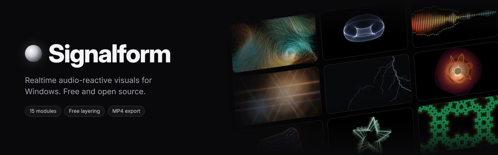
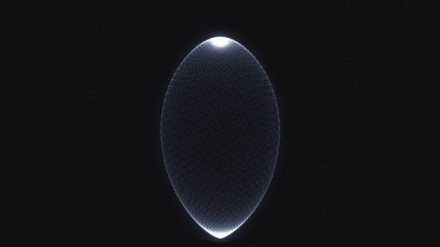
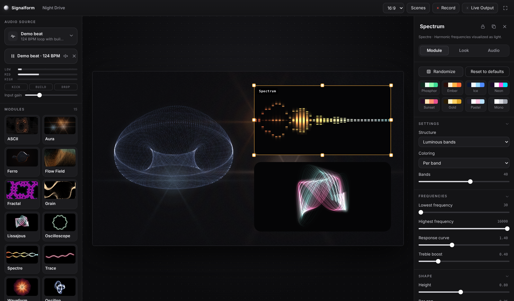
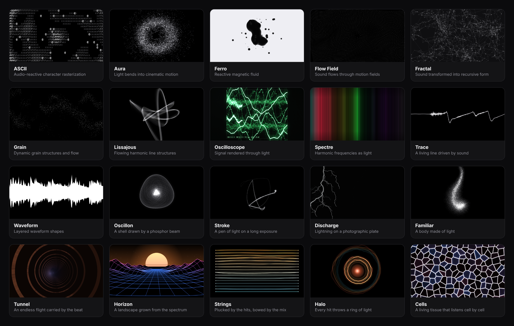

<p align="center">
  
</p>

<p align="center">
  <a href="https://github.com/Kuzuw/signalform/releases/latest"></a>
  <a href="https://github.com/Kuzuw/signalform/releases"></a>
  <a href="https://github.com/Kuzuw/signalform/actions/workflows/build.yml"></a>
  
  <a href="LICENSE"></a>
</p>

<p align="center">
  <b>Turn any sound into live visuals.</b> Fifteen audio-reactive modules you can layer, resize and blend<br>
  into one composition, then record it, render a track to MP4 or perform it full screen. No DAW required.
</p>

<p align="center">
  <a href="https://github.com/Kuzuw/signalform/releases/latest"><b>Download for Windows</b></a> ·
  <a href="docs/MODULES.md">Module reference</a> ·
  <a href="#quick-start">Quick start</a> ·
  <a href="#build-from-source">Build from source</a> ·
  <a href="CHANGELOG.md">Changelog</a>
</p>

<p align="center">
  
</p>

## Contents

- [Highlights](#highlights)
- [Modules](#modules)
- [Download and install](#download-and-install)
- [Quick start](#quick-start)
- [Keyboard and mouse](#keyboard-and-mouse)
- [Audio sources](#audio-sources)
- [Recording and export](#recording-and-export)
- [Live Output](#live-output)
- [FAQ](#faq)
- [Build from source](#build-from-source)
- [Architecture](#architecture)
- [Roadmap](#roadmap)
- [Contributing](#contributing)
- [License](#license)

## Highlights



| Feature | What you get |
|---|---|
| **15 visual modules** | From phosphor oscilloscopes and lightning to a 100,000-point creature that can spell words. GPU-accelerated where it matters. |
| **Free composition** | Every module is a widget. Move, resize, layer, blend, group, align, lock, hide or duplicate it. Cards can be glass, solid, dark, light or clear, with rounded corners. |
| **Deep control** | Each widget has three tabs: **Module** (its own settings, eight color palettes, presets, Randomize), **Look** (color, transform, mirror and kaleidoscope, glow, trails, pixelate, vignette) and **Audio** (reactivity, which part of the mix it hears, smoothing, hit strength, speed). |
| **Music-aware analysis** | Bass, mid and high levels; kick, snare and hi-hat detection; pitch; and build-up and drop detection, shared by every module. |
| **Any sound in** | What your PC is playing, a microphone or audio interface, a virtual cable, a track file, or the built-in demo beat. |
| **Video out** | Render a track to MP4 with its audio, or record live takes of the whole stage, a group or a single widget. |
| **Scenes and presets** | Save whole layouts as scenes (and share them as `.sfscene` files), or save module settings as presets. Seven starter scenes are included. |
| **Free and open source** | MIT licensed. No account, no license key, no telemetry. |

## Modules

<p align="center"></p>

| Module | What it does | Reacts to |
|---|---|---|
| **ASCII** | Rasterizes noise, the spectrum, the waveform or your own text into glyphs (blocks, dots, binary, hex, katakana or your own set). | Columns follow frequencies; bass punches the density; hats sparkle. |
| **Aura** | Soft light sources with optical streaks and diffraction spikes that drift, orbit or pass by. | Bass and mids swell the light; kicks and drops flare it. |
| **Ferro** | A metallic magnetic fluid that grows spikes, with orbiting droplets and rim light. | Bass raises the spikes; kicks jolt it; it tightens on a build and bursts on the drop. |
| **Flow Field** | Thousands of particles streaming through curl-noise, vortex, wave, radial or crosshatch fields. | Bass drives the flow; kicks burst it outwards; highs add turbulence. |
| **Fractal** | Julia, Kali and folded-geometry fractals with kaleidoscope symmetry and color cycling. | Bass and mids deform it; the brightness of the sound shifts its colors; drops push it further. |
| **Grain** | Thousands of grains flowing over a surface that remembers where they have been. | Bass shakes it; hits scatter the grains; hats add sparkle. |
| **Lissajous** | Layered harmonic curves with 3D tilt and tumble. | Pitch sets the ratios, or the stereo X/Y signal draws the figure. |
| **Oscilloscope** | A phosphor scope: waveform (Y/T), stereo phase (X/Y) or a custom shape, which you can draw on the widget. | The raw waveform, with echoes and afterglow. |
| **Spectre** | The spectrum as luminous bands, layers, a flowing spectrogram or a ring. | Every band, with peak caps and a response curve you can tune. |
| **Trace** | Up to 12 parallel lines as an open line, a closed loop or a spiral. | Each part of the spectrum bends its own stretch of line; hits send ripples along it. |
| **Waveform** | Layered waveforms as radial rings, stacked contours or a mirrored mass, with rotation and twist. | The waveform shapes each layer; kicks thicken the lines. |
| **Oscillon** | A phosphor beam sweeps a closed surface until it becomes a glowing shell. | Snaps to a new form on heavy hits, squeezes on a build and opens on the drop. |
| **Stroke** | A pen of light on a long exposure. Slow strokes burn thick, fast ones thin to a wire. | Follows the melody; hits break the line into flaring corners. |
| **Discharge** | Lightning on a photographic plate. | Kicks tear long channels, snares throw arcs, hats crackle; it holds back through a build and breaks loose on the drop. |
| **Familiar** | Up to 100,000 points of light that rest as one creature, or become a word you type. | Breathes in silence, scatters on hits and gathers back. |

Every control of every module, with ranges and defaults, is listed in the **[module reference](docs/MODULES.md)**.

## Download and install

1. Download **`Signalform-Setup-x.y.z.exe`** from the [latest release](https://github.com/Kuzuw/signalform/releases/latest).
2. Run it and pick an install folder.
3. The installer isn't code-signed yet, so Windows SmartScreen may warn you. Choose **More info** → **Run anyway**. The installer is built from this repository by [GitHub Actions](.github/workflows/build.yml), and you can [build it yourself](#build-from-source) instead.

**Requirements**

| | Minimum | Recommended |
|---|---|---|
| OS | Windows 10, 64-bit | Windows 11, 64-bit |
| GPU | Any GPU with WebGL 2 | A dedicated GPU for big stages or many particles |

## Quick start

1. **Pick a sound.** Open the **Audio source** card at the top left and choose **Connect** to capture what your PC is playing, an input, a track file, or the demo beat.
2. **Add modules.** Click a tile in the library, or drag it onto the stage. Add as many as you like.
3. **Compose.** Drag widgets to move them and pull their edges to resize. Use the inspector's **Background** to make a card glass, solid or clear, and **Blend** to mix it with the layers below.
4. **Shape each widget.** Change its settings in **Module**, its picture in **Look** and how it hears the music in **Audio**. **Randomize** rolls a new look; double-click any slider to reset it.
5. **Save** the layout with **Scenes** (Ctrl+S), then **Record**, export a video, or press **F** to perform full screen.

> [!TIP]
> Not sure where to start? Open **Scenes** and load a starter: *Phosphor Room*, *Three Cards*, *Storm Shell*, *Long Exposure*, *Magnetic*, *Paper* or *Vertical Story*.

## Keyboard and mouse

| Action | Shortcut |
|---|---|
| Play / pause the track or demo beat | <kbd>Space</kbd> |
| Perform mode (visuals only) | <kbd>F</kbd>, <kbd>Esc</kbd> to leave |
| Scenes | <kbd>Ctrl</kbd>+<kbd>S</kbd> |
| Select all widgets | <kbd>Ctrl</kbd>+<kbd>A</kbd> |
| Select several | <kbd>Shift</kbd>+click |
| Group / ungroup | <kbd>Ctrl</kbd>+<kbd>G</kbd> / <kbd>Ctrl</kbd>+<kbd>Shift</kbd>+<kbd>G</kbd> |
| Pick one widget inside a group | Double-click |
| Duplicate / delete | <kbd>Ctrl</kbd>+<kbd>D</kbd> / <kbd>Delete</kbd> |
| Bring forward / send backward | <kbd>]</kbd> / <kbd>[</kbd> |
| Nudge (bigger steps) | Arrow keys (with <kbd>Shift</kbd>) |
| Resize keeping the shape / without snapping | Drag a corner with <kbd>Shift</kbd> / with <kbd>Alt</kbd> |
| Reset a slider / type an exact value | Double-click the slider / click its number |
| Widget menu | Right-click a widget |

## Audio sources

| Source | Use it for |
|---|---|
| **Connect** (system audio) | Whatever your PC is playing: Spotify, YouTube, a DAW, a game. Captures the default output device. |
| **Inputs** | A microphone, a mixer or an audio interface. |
| **Virtual cables** | [VB-Cable](https://vb-audio.com/Cable/) or [Voicemeeter](https://vb-audio.com/Voicemeeter/) to route one app's audio only. |
| **Track** | An audio file. Loop it, monitor it, scrub it and export a video from it. |
| **Demo beat** | A built-in 124 BPM loop with builds and drops, for trying things out without music. |

## Recording and export

- **Export video from this track** plays a loaded track from the start and renders the stage to an MP4 (H.264 + AAC) with the track's audio. It runs in real time, so it takes as long as the track.
- **Record** captures a live take of whatever is playing. The **Record Widget** dialog lets you record the whole stage, a group or one widget, at 720p, 1080p, 1440p or 4K and 30 or 60 fps, with or without audio.
- When a take ends, you choose where to save it (your Videos folder by default). Videos are saved as MP4; the bundled ffmpeg converts them when needed.

## Live Output

**Live Output** can send the stage, a group or one widget as a live video source over **Spout** and **NDI**, for Resolume, OBS, TouchDesigner and other VJ tools.

> [!NOTE]
> Spout and NDI depend on native add-ons that the release build tries to compile. In the current release they are not bundled, so the dialog shows them as unavailable along with the reason. Until then, capture the Signalform window in OBS (Window Capture) or use Perform mode on a second screen. If you can help package the add-ons, see [Contributing](#contributing) and `main/outputs/`.

## FAQ

<details>
<summary><b>Connect doesn't hear anything.</b></summary>

Connect captures the **default** output device. Check that the music plays through that device (Windows Settings → System → Sound → Output), and that it isn't muted. If your audio goes to a device that isn't the default, choose it as an input via a virtual cable instead.
</details>

<details>
<summary><b>The visuals stutter or the frame rate is low.</b></summary>

Lower the particle or point count of Flow Field, Familiar and Oscillon, turn off **Smooth edges** in Fractal, use fewer widgets, or pick a smaller stage aspect. On laptops, make sure Signalform runs on the dedicated GPU (Windows Settings → System → Display → Graphics).
</details>

<details>
<summary><b>Can I use it with my DAW?</b></summary>

Yes. Play from the DAW and use **Connect**, or route the DAW's output to a virtual cable and pick that cable as the input.
</details>

<details>
<summary><b>Is there a macOS or Linux version?</b></summary>

Not at the moment. Signalform is built and tested for Windows. The code is plain Electron, so ports are possible, and contributions are welcome.
</details>

<details>
<summary><b>Where are my scenes and presets stored?</b></summary>

In your Windows user profile (`%APPDATA%\Signalform`). Scenes can also be exported and imported as `.sfscene` files from the Scenes dialog.
</details>

<details>
<summary><b>Does it collect any data?</b></summary>

No. Signalform has no accounts, analytics or telemetry, and it doesn't connect to the internet.
</details>

## Build from source

You need [Node.js 20+](https://nodejs.org) and Git on Windows.

```bash
git clone https://github.com/Kuzuw/signalform.git
cd signalform
npm install
npm start          # run the app
npm run dev        # run with DevTools
npm run dist       # build dist/Signalform-Setup-x.y.z.exe
```

### Releases

Releases are fully automated by [`.github/workflows/build.yml`](.github/workflows/build.yml):

1. Bump `version` in `package.json` and add an entry to [`CHANGELOG.md`](CHANGELOG.md).
2. Push to `main`.
3. About ten minutes later the release `v<version>` appears with the installer. The workflow creates the tag.

Pushes that keep the same version rebuild that release's installer; documentation-only changes don't trigger a build. To sign the installer, add a code-signing certificate as the secrets `WIN_CERT_PFX_BASE64` and `WIN_CERT_PASSWORD`.

## Architecture

```
main/                 Electron main process
  main.js             window, menus, app:// protocol, recording files, ffmpeg transcode
  store.js            scenes, presets and settings on disk
  preload.js          the small, typed bridge the UI talks to (window.sf)
  outputs/            Spout and NDI adapters
renderer/             the interface (plain ES modules, no build step)
  audio.js            sources and analysis: levels, onsets, pitch, build and drop
  stage.js            widgets, layout, layering, groups and the compositor
  fx.js               per-widget Look and Audio controls
  inspector.js        the Module / Look / Audio panel, generated from parameter schemas
  modules/            the 15 visual modules (WebGL 2 for Aura, Ferro and Fractal, Canvas 2D for the rest)
docs/                 module reference and README images
scripts/              generators for docs/MODULES.md and the README images
test/                 headless interface, module and render tests
```

Each frame, `audio.js` produces one analysis frame. Every widget reshapes it through its **Audio** settings, its module draws into an offscreen canvas, the **Look** pass applies color, transform and effects, and the compositor stacks the widgets with their backgrounds and blend modes.

## Roadmap

- [ ] Bundle the Spout and NDI add-ons in the release build
- [ ] Code-signed installer
- [ ] MIDI and OSC control of any parameter
- [ ] Automatic updates
- [ ] More modules

Ideas and votes are welcome in [Issues](https://github.com/Kuzuw/signalform/issues).

## Contributing

Bug reports, ideas and pull requests are welcome. A new module is a single file in `renderer/modules/`: its settings panel is generated from its parameter list. See **[CONTRIBUTING.md](CONTRIBUTING.md)** for the module API, the tests and the pull request checklist.

Please follow the [Code of Conduct](CODE_OF_CONDUCT.md), and report security issues privately as described in [SECURITY.md](SECURITY.md).

## License

Signalform is free software under the [MIT License](LICENSE). The bundled [ffmpeg](https://ffmpeg.org) build (via `ffmpeg-static`) is licensed under the GPL.
