# Module reference

> Generated from the code by `npm run docs:modules`. Do not edit by hand.

Signalform ships with 20 modules. Every widget also has the shared [Look](#look-every-widget) and [Audio](#audio-every-widget) controls, whatever its module.

[ASCII](#ascii) · [Aura](#aura) · [Ferro](#ferro) · [Flow Field](#flow-field) · [Fractal](#fractal) · [Grain](#grain) · [Lissajous](#lissajous) · [Oscilloscope](#oscilloscope) · [Spectre](#spectre) · [Trace](#trace) · [Waveform](#waveform) · [Oscillon](#oscillon) · [Stroke](#stroke) · [Discharge](#discharge) · [Familiar](#familiar) · [Tunnel](#tunnel) · [Horizon](#horizon) · [Strings](#strings) · [Halo](#halo) · [Cells](#cells)

## ASCII

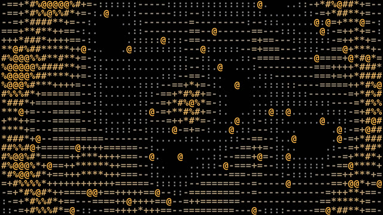

*Audio-reactive character rasterization.*

| Section | Control | Range / options | Default |
|---|---|---|---|
| **Settings** | Source | Noise field · Spectrum · Waveform · Your text | Noise field |
|  | Text shown when Source: Your text | text | `SIGNAL` |
| **Glyphs** | Glyph set | Signs x X % & # @ · Classic  .:-=+*#%@ · Blocks ░▒▓█ · Dots ·•● · Binary 01 · Hex 0–F · Lines -=≡ · Katakana · My characters | Signs x X % & # @ |
|  | Characters (light → dense) shown when Glyph set: My characters | text | ` .:-=+*#%@` |
|  | Weight | Light · Regular · Medium · Bold | Bold |
|  | Glyph size | 6 – 40 | 18 |
|  | Letter spacing | 0.45 – 1.2 | 0.62 |
| **Motion** | Density | 0.2 – 2 | 1.35 |
|  | Glyph motion | Still · Drift · Rain · Jitter | Drift |
|  | Motion speed | 0 – 3 | 1 |
|  | Bass punch | 0 – 2 | 1 |
|  | Hi-hat sparkle | 0 – 2 | 1 |
|  | Columns follow frequencies | on / off | on |
| **Color** | Coloring | Single color · By intensity · By frequency | By intensity |
|  | Color A | color | `#3c3c42` |
|  | Color B | color | `#f4f4f6` |
|  | Invert | on / off | off |

## Aura

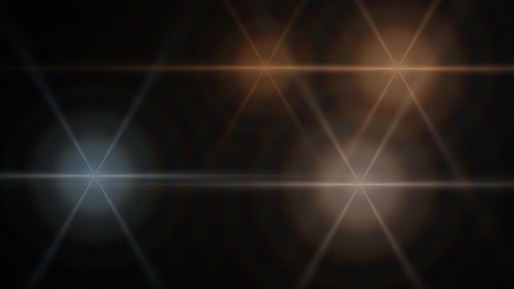

*Light bends into cinematic motion.*

| Section | Control | Range / options | Default |
|---|---|---|---|
| **Settings** | Look | A ring of specks · Light blooms | A ring of specks |
| **Specks** | Shape shown when Look: A ring of specks | Ring · Two rings · Disc · Turning sphere | Ring |
|  | Specks shown when Look: A ring of specks | 2000 – 60000 | 11000 |
|  | Size shown when Look: A ring of specks | 0.3 – 1.6 | 1 |
|  | Thickness shown when Look: A ring of specks | 0.1 – 2 | 1 |
|  | Width shown when Look: A ring of specks | 0.6 – 1.6 | 1.12 |
|  | Scattered specks shown when Look: A ring of specks | 0 – 0.5 | 0.22 |
|  | Wobble shown when Look: A ring of specks | 0 – 2 | 0.8 |
|  | Shimmer shown when Look: A ring of specks | 0 – 2 | 1 |
|  | Speck size shown when Look: A ring of specks | 0.5 – 3 | 1.1 |
|  | Haze shown when Look: A ring of specks | 0 – 2 | 0.45 |
|  | Speck color shown when Look: A ring of specks | color | `#ffffff` |
|  | Haze color shown when Look: A ring of specks | color | `#55555c` |
| **Blooms** | Color A shown when Look: Light blooms | color | `#ff8a3d` |
|  | Color B shown when Look: Light blooms | color | `#5ab8ff` |
|  | Softness shown when Look: Light blooms | 0.3 – 3 | 1.2 |
|  | Intensity shown when Look: Light blooms | 0.2 – 3 | 1 |
|  | Motion shown when Look: Light blooms | Drifting · Orbiting · Passing by · Still in a row | Drifting |
|  | Spread shown when Look: Light blooms | 0.2 – 2 | 1 |
|  | Light sources shown when Look: Light blooms | 1 – 7 | 4 |
|  | Optical streaks shown when Look: Light blooms | 0 – 1.5 | 0.6 |
|  | Diffraction spikes shown when Look: Light blooms | None · 4 points · 6 points · 8 points | 6 points |
|  | Diffraction color split shown when Look: Light blooms | 0 – 2 | 0.8 |
|  | Film grain shown when Look: Light blooms | 0 – 0.12 | 0.03 |
| **Motion** | Motion speed | 0 – 3 | 1 |

## Ferro

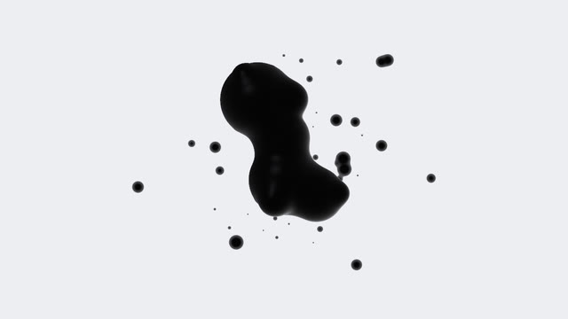

*Reactive magnetic fluid simulation.*

| Section | Control | Range / options | Default |
|---|---|---|---|
| **Body** | Body segments | 1 – 6 | 4 |
|  | Buds | 0 – 7 | 5 |
|  | Body size | 0.4 – 1.6 | 1 |
|  | Merging | 0 – 1 | 0.5 |
|  | Uneven beads | 0 – 1 | 0.55 |
|  | Turbulence | 0 – 2 | 0.8 |
|  | Drift and turn | 0 – 2 | 0.6 |
|  | Pull into one drop | Never · On drops · On drops and heavy kicks | Never |
| **Spikes and spray** | Spikes | 0 – 2 | 1 |
|  | Droplets | 0 – 48 | 40 |
|  | Fling on hits | 0 – 2 | 1 |
|  | Magnetic pull | 0 – 2 | 0.6 |
| **Light** | Background | color | `#eeeef3` |
|  | Fluid | color | `#050506` |
|  | Rim light | 0 – 2 | 1 |
|  | Gloss | 0 – 3 | 1 |
|  | Zoom | 0.5 – 2 | 1 |
|  | Motion speed | 0 – 3 | 1 |

## Flow Field

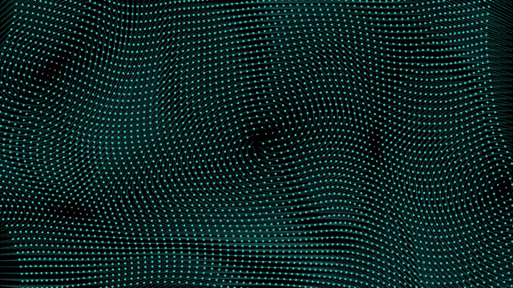

*Sound flows through motion fields.*

| Section | Control | Range / options | Default |
|---|---|---|---|
| **Settings** | Look | A grid of points carried by the field · Particle streams | A grid of points carried by the field |
|  | Grid spacing shown when Look: A grid of points carried by the field | 6 – 40 | 15 |
|  | Displacement shown when Look: A grid of points carried by the field | 0 – 4 | 1.6 |
|  | Point size shown when Look: A grid of points carried by the field | 0.5 – 4 | 1.2 |
| **Field** | Stream pattern | Curl noise · Vortex · Waves · Radial burst · Crosshatch | Curl noise |
|  | Particles | 500 – 20000 | 4000 |
|  | Flow speed | 0.1 – 4 | 1 |
|  | Field scale | 0.2 – 4 | 1 |
|  | Turbulence | 0 – 3 | 1 |
|  | Field evolution | 0 – 3 | 1 |
|  | Burst on hits | 0 – 2 | 1 |
|  | Particles start | Everywhere · From the center · From the edges · From the bottom | Everywhere |
|  | Particle life | 0.2 – 3 | 1 |
| **Drawing** | Trail length | 0.5 – 0.99 | 0.9 |
|  | Particle shape | Streaks · Dots · Dashes | Streaks |
|  | Brightness | 0.1 – 3 | 1 |
|  | Line width | 0.5 – 4 | 1 |
| **Color** | Coloring | By direction · By speed · Single color | Single color |
|  | Color A | color | `#e6e6ea` |
|  | Color B | color | `#38c6c0` |

## Fractal

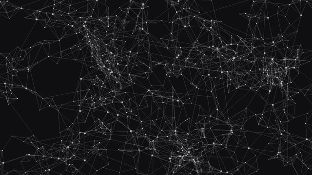

*Sound transformed into recursive form.*

| Section | Control | Range / options | Default |
|---|---|---|---|
| **Settings** | Structure | Recursive network · Julia set · Kali set · Folded geometry | Recursive network |
|  | Recursion depth shown when Structure: Recursive network | 2 – 5 | 4 |
|  | Branches per level shown when Structure: Recursive network | 2 – 6 | 4 |
|  | Links per point shown when Structure: Recursive network | 1 – 6 | 3 |
|  | Long links shown when Structure: Recursive network | 0 – 1 | 0.45 |
|  | Cluster tightness shown when Structure: Recursive network | 0.25 – 0.7 | 0.6 |
|  | Motion shown when Structure: Recursive network | 0 – 2 | 0.7 |
|  | Rewire on drops and heavy hits shown when Structure: Recursive network | on / off | on |
| **Network look** | Lines shown when Structure: Recursive network | color | `#d8d8de` |
|  | Line brightness shown when Structure: Recursive network | 0.05 – 1 | 0.34 |
|  | Point size shown when Structure: Recursive network | 0 – 4 | 1.2 |
|  | Background shown when Structure: Recursive network | color | `#0f0f11` |
|  | Detail (iterations) shown when Structure: Julia set / Kali set / Folded geometry | 6 – 160 | 24 |
|  | Zoom shown when Structure: Julia set / Kali set / Folded geometry | 0.3 – 4 | 1 |
|  | Kaleidoscope segments shown when Structure: Julia set / Kali set / Folded geometry | 1 – 16 | 1 |
|  | Rotation speed shown when Structure: Julia set / Kali set / Folded geometry | 0 – 2 | 0.3 |
|  | Harmonic deformation shown when Structure: Julia set / Kali set / Folded geometry | 0 – 3 | 1 |
|  | Pan X shown when Structure: Julia set / Kali set / Folded geometry | -1.5 – 1.5 | 0 |
|  | Pan Y shown when Structure: Julia set / Kali set / Folded geometry | -1.5 – 1.5 | 0 |
| **Color** | Color cycling shown when Structure: Julia set / Kali set / Folded geometry | 0 – 1 | 0.1 |
|  | Palette shift shown when Structure: Julia set / Kali set / Folded geometry | 0 – 1 | 0.05 |
|  | Saturation shown when Structure: Julia set / Kali set / Folded geometry | 0 – 1.4 | 0.9 |
|  | Glow shown when Structure: Julia set / Kali set / Folded geometry | 0 – 2 | 1 |
|  | Smooth edges (uses more GPU) shown when Structure: Julia set / Kali set / Folded geometry | on / off | on |
| **Motion** | Evolution speed | 0 – 3 | 1 |

## Grain

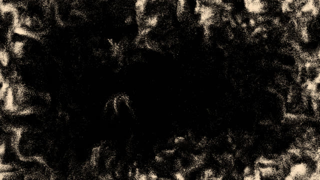

*Dynamic grain structures and flow.*

| Section | Control | Range / options | Default |
|---|---|---|---|
| **Settings** | Look | Drifting dust bands · Grain texture | Drifting dust bands |
|  | Bands shown when Look: Drifting dust bands | 1 – 9 | 5 |
|  | Specks shown when Look: Drifting dust bands | 1000 – 30000 | 7000 |
|  | Waviness shown when Look: Drifting dust bands | 0 – 2 | 1 |
|  | Band thickness shown when Look: Drifting dust bands | 0.2 – 3 | 1 |
|  | Dust color shown when Look: Drifting dust bands | color | `#ffffff` |
|  | Grains shown when Look: Grain texture | 5000 – 120000 | 50000 |
|  | Grain size | 1 – 6 | 2 |
|  | Flow speed | 0 – 3 | 1 |
|  | Turbulence | 0 – 3 | 1 |
|  | Pattern scale | 0.3 – 3 | 1 |
|  | Surface memory | 0.5 – 0.99 | 0.9 |
|  | Drift | Wander · Rise · Fall like sand · Wind · Swirl | Wander |
|  | Bass shake | 0 – 2 | 1 |
|  | Scatter on hits | 0 – 2 | 1 |
|  | Shadow color shown when Look: Grain texture | color | `#3a2a1f` |
|  | Highlight color shown when Look: Grain texture | color | `#ffd9a8` |
|  | Contrast | 0.2 – 3 | 1 |

## Lissajous

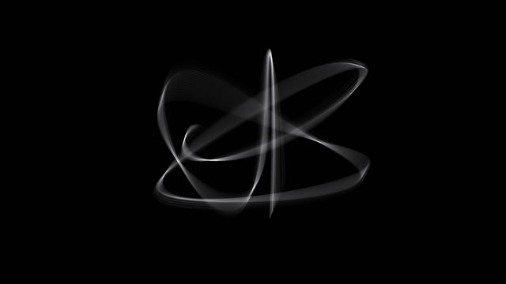

*Flowing harmonic line structures.*

| Section | Control | Range / options | Default |
|---|---|---|---|
| **Settings** | Curve source | Harmonic (follows pitch) · Stereo X/Y signal · Both layered | Harmonic (follows pitch) |
|  | Frequency ratio | Auto from sound · 1 : 1 · 1 : 2 · 2 : 3 · 3 : 4 · 3 : 5 · 4 : 5 · 5 : 6 · 5 : 8 · 2 : 5 · 3 : 7 | Auto from sound |
|  | Knot complexity | 0 – 1.5 | 0.35 |
|  | Layers | 1 – 40 | 22 |
|  | Layer phase spread | 0 – 1 | 0.05 |
|  | Phase drift | 0 – 3 | 0.6 |
|  | Size | 0.2 – 1.2 | 0.62 |
|  | 3D tilt | 0 – 1.5 | 0.9 |
|  | Tumble speed | 0 – 2 | 0.5 |
|  | Signal interference | 0 – 2 | 0.7 |
|  | Line width | 0.3 – 5 | 0.35 |
|  | Glow | 0 – 2 | 0.25 |
|  | Persistence | 0 – 0.97 | 0.55 |
|  | Color A | color | `#ffffff` |
|  | Color B | color | `#b8b8c0` |

## Oscilloscope

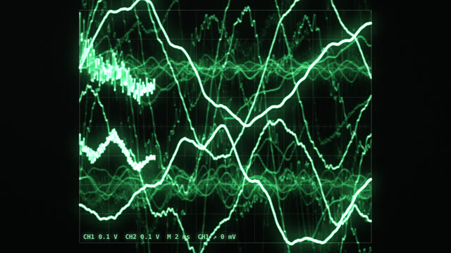

*Signal rendered through light.*

| Section | Control | Range / options | Default |
|---|---|---|---|
| **Settings** | Display | Waveform (Y/T) · Stereo phase (X/Y) · Custom shape · A picture | Stereo phase (X/Y) |
|  | Choose a picture… shown when Display: A picture | button |  |
|  | Beam points shown when Display: A picture | 500 – 12000 | 4000 |
|  | Edge detail shown when Display: A picture | 0 – 1 | 0.45 |
|  | Shade dark areas shown when Display: A picture | 0 – 1 | 0 |
|  | Light subject on dark shown when Display: A picture | on / off | off |
|  | Picture size shown when Display: A picture | 0.3 – 1.4 | 1 |
|  | Wobble with the sound shown when Display: A picture | 0 – 3 | 1 |
|  | Beam sweep shown when Display: A picture | 0.05 – 1 | 1 |
|  | Show beam jumps shown when Display: A picture | on / off | off |
|  | Shape shown when Display: Custom shape | Circle · Square · Triangle · Star · Heart · Infinity · My drawing | Circle |
|  | Draw a shape on the widget shown when Display: Custom shape | button |  |
|  | Gain | 0.1 – 4 | 1 |
|  | Channels shown when Display: Waveform (Y/T) | Mono mix · Left + right | Left + right |
|  | Shape rotation shown when Display: Custom shape | -2 – 2 | 0.2 |
|  | Echoes | 0 – 8 | 0 |
|  | Echo size step shown when Echoes ≥ 1 | -0.3 – 0.3 | -0.12 |
|  | Echo twist shown when Echoes ≥ 1 | -90 – 90 | 12 |
| **Phosphor** | Phosphor persistence | 0 – 0.97 | 0.8 |
|  | Beam width | 0.5 – 5 | 1.5 |
|  | Optical bloom | 0 – 2 | 1 |
| **Color** | Phosphor color | color | `#2fe3a2` |
|  | Graticule | on / off | off |

## Spectre

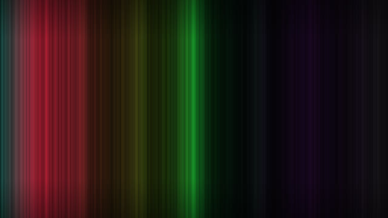

*Harmonic frequencies visualized as light.*

| Section | Control | Range / options | Default |
|---|---|---|---|
| **Settings** | Structure | Spectral lines · Luminous bands · Spectral layers · Flowing spectrogram · Radial spectrum | Spectral lines |
|  | Coloring | Light spectrum · Per band · Monochrome | Light spectrum |
|  | Bands | 8 – 64 | 48 |
| **Frequencies** | Lowest frequency | 30 – 2000 | 30 |
|  | Highest frequency | 400 – 16000 | 16000 |
|  | Equalize bands shown when Structure: Spectral lines | on / off | on |
|  | Response curve | 0.5 – 3 | 1.4 |
|  | Treble boost | 0 – 2 | 0.4 |
|  | Layers shown when Structure: Spectral layers / Flowing spectrogram | 1 – 24 | 10 |
| **Shape** | Height | 0.2 – 1.5 | 0.8 |
|  | Bar gap shown when Structure: Luminous bands / Radial spectrum | 0 – 0.9 | 0.36 |
|  | Rounded bars shown when Structure: Luminous bands | on / off | on |
|  | Peak caps shown when Structure: Luminous bands / Radial spectrum | on / off | on |
|  | Mirror | on / off | on |
|  | Fall smoothing | 0 – 0.98 | 0.82 |
|  | Glow | 0 – 2 | 1 |
|  | Persistence | 0 – 0.95 | 0.4 |
| **Color** | Low frequencies | color | `#ff4d2e` |
|  | Mid frequencies | color | `#ffd166` |
|  | High frequencies | color | `#5ad1ff` |
|  | Monochrome color shown when Coloring: Monochrome | color | `#e8eefc` |

## Trace

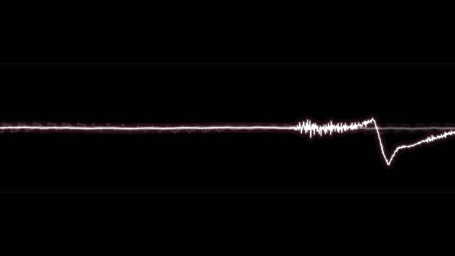

*A living line driven by sound.*

| Section | Control | Range / options | Default |
|---|---|---|---|
| **Settings** | Form | Live signal · Open line · Closed loop · Spiral | Live signal |
|  | Signal gain shown when Form: Live signal | 0.5 – 8 | 2.6 |
|  | Time window shown when Form: Live signal | 0.1 – 1 | 1 |
|  | Clip at the edges shown when Form: Live signal | on / off | on |
|  | Automatic gain shown when Form: Live signal | on / off | on |
|  | Lines | 1 – 12 | 1 |
|  | Line spacing shown when Lines ≥ 2 | 0 – 1 | 0.25 |
|  | Line delay shown when Lines ≥ 2 | 0 – 1 | 0.3 |
| **Motion** | Control points | 8 – 96 | 40 |
|  | Tension | 0.2 – 4 | 1.2 |
|  | Damping | 0.5 – 0.99 | 0.86 |
|  | Deformation | 0 – 2 | 1 |
|  | Shape drift | 0 – 2 | 0.6 |
|  | Ripple on hits | 0 – 2 | 1 |
| **Light** | Thickness | 0.5 – 8 | 2.2 |
|  | Glow | 0 – 2 | 1 |
|  | Afterimage | 0 – 0.97 | 0.7 |
|  | Color A | color | `#f4f1ff` |
|  | Color B | color | `#ff5c8a` |

## Waveform

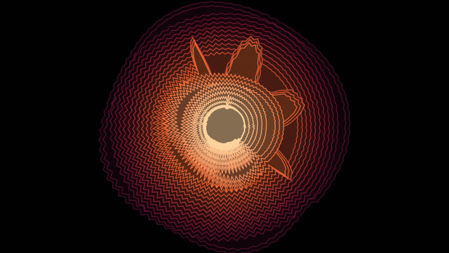

*Layered waveform shapes from audio.*

| Section | Control | Range / options | Default |
|---|---|---|---|
| **Settings** | Arrangement | Scrolling mass · Radial rings · Stacked contours · Mirrored layers | Scrolling mass |
|  | Body thickness shown when Arrangement: Scrolling mass | 0 – 0.4 | 0.12 |
|  | Spikiness shown when Arrangement: Scrolling mass | 0 – 2 | 1 |
|  | Layers | 3 – 60 | 24 |
|  | Layer spacing | 0.2 – 2 | 1 |
|  | Amplitude | 0.1 – 3 | 1 |
|  | Detail | 32 – 400 | 160 |
|  | Filled shapes | on / off | on |
|  | Color | Multi-color palette · Single color | Single color |
|  | Palette shown when Color: Multi-color palette | Ember · Glacier · Acid · Dusk · Mono | Ember |
|  | Single color shown when Color: Single color | color | `#ffffff` |
|  | Line width | 0.5 – 4 | 1.2 |
|  | Flow speed | 0.2 – 3 | 1 |
|  | Ring rotation shown when Arrangement: Radial rings | -2 – 2 | 0.25 |
|  | Layer twist shown when Arrangement: Radial rings | -1 – 1 | 0 |
|  | Thicken on kicks | 0 – 3 | 0.8 |

## Oscillon

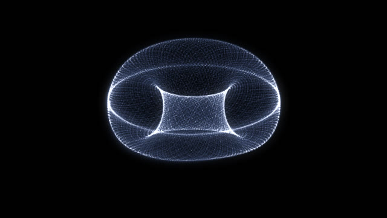

*A shell drawn by a phosphor beam.*

| Section | Control | Range / options | Default |
|---|---|---|---|
| **Shape** | Form | Changes with the music · Cushion · Pebble · Peanut · Trefoil · Apple · Ring · Clover · Orb · Your picture | Changes with the music |
|  | Choose a picture… shown when Form: Your picture | button |  |
|  | Edge detail shown when Form: Your picture | 0 – 1 | 0.45 |
|  | Shade dark areas shown when Form: Your picture | 0 – 1 | 0 |
|  | Light subject on dark shown when Form: Your picture | on / off | off |
|  | Sway in 3D shown when Form: Your picture | 0 – 1.5 | 0.5 |
|  | Snap to a new form shown when Form: Changes with the music | On heavy hits and drops · Only on drops · Never | On heavy hits and drops |
|  | Snap speed shown when Form: Changes with the music | 0.5 – 10 | 5 |
|  | Scale | 0.3 – 1.6 | 1 |
|  | Swelling from sounds | 0 – 2.5 | 1 |
|  | Squeeze on build, open on drop | on / off | on |
|  | Wobble | 0 – 2 | 0.6 |
|  | Frayed surface | 0 – 2 | 0.5 |
| **Beam** | Beam samples per frame | 8000 – 120000 | 32000 |
|  | Beam weave | 3 – 160 | 23 |
|  | Weave ratio | 0.2 – 1.5 | 0.618 |
|  | Beam speed | 0.1 – 3 | 1 |
|  | Phosphor persistence | 0 – 0.97 | 0.7 |
|  | Rotation | -2 – 2 | 0.25 |
| **Light** | Phosphor | color | `#f2f2f2` |
|  | Shadow tint | color | `#3c3c40` |
|  | Exposure | 0.2 – 4 | 1.15 |
|  | Bloom | 0 – 2 | 0.9 |

## Stroke

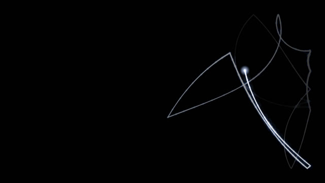

*A pen of light on a long exposure.*

| Section | Control | Range / options | Default |
|---|---|---|---|
| **Motion** | Pen speed | 0.1 – 3 | 1 |
|  | Follow the melody | 0 – 1 | 0.6 |
|  | Wander | 0 – 2 | 0.55 |
|  | Corner on hits | 0 – 1 | 0.7 |
|  | Race a laser figure on big drops | on / off | on |
| **Light** | Exposure length | 0.5 – 0.998 | 0.992 |
|  | Slow stroke width | 1 – 24 | 9 |
|  | Fast stroke width | 0.3 – 4 | 0.8 |
|  | Flare size | 0 – 2 | 1 |
|  | Light | color | `#ffffff` |
|  | Halo | color | `#c4c8d0` |

## Discharge

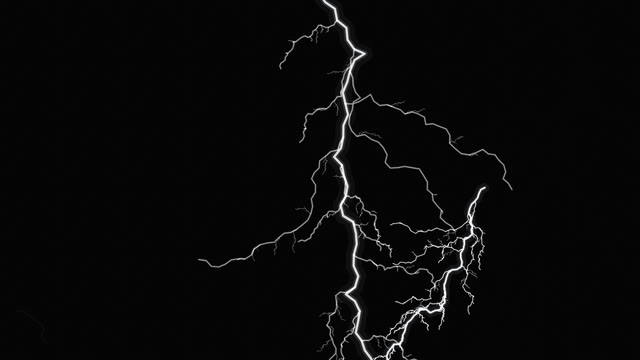

*Lightning on a photographic plate.*

| Section | Control | Range / options | Default |
|---|---|---|---|
| **Strikes** | Strikes come from | Every sound · Kicks only · Kicks and snares | Every sound |
|  | Strikes start from | The top · The bottom · The sides · The center · Anywhere | The top |
|  | Sensitivity | 0.2 – 2 | 1 |
|  | Channel length | 0.3 – 1.6 | 1 |
|  | Branching | 0 – 3 | 1.8 |
|  | Roughness | 0.3 – 2 | 1 |
|  | Hold back on builds, break loose on drops | on / off | on |
| **Plate** | Channel width | 0.3 – 4 | 1.1 |
|  | Afterglow | 0 – 0.95 | 0.55 |
|  | Sky flash | 0 – 1.5 | 0.35 |
|  | Plate grain | 0 – 1 | 0.08 |
|  | Core | color | `#ffffff` |
|  | Glow | color | `#d2d6e0` |

## Familiar

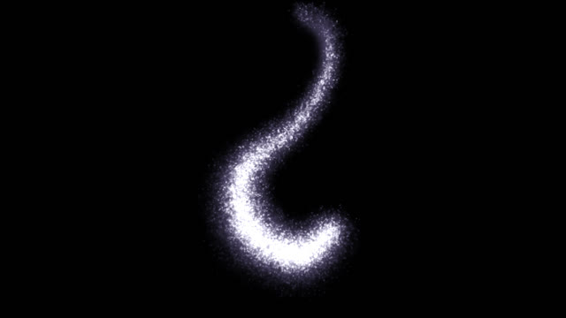

*A body made of light.*

| Section | Control | Range / options | Default |
|---|---|---|---|
| **Body** | Body | Creature · Orb · Your word | Creature |
|  | Word shown when Body: Your word | text | `SIGNAL` |
|  | Points of light | 5000 – 100000 | 32000 |
|  | Size | 0.3 – 1.6 | 1.1 |
| **Behavior** | Breathing | 0 – 2 | 1 |
|  | Scatter on hits | 0 – 2 | 1 |
|  | Gathers back | 0.2 – 3 | 1 |
|  | Sway | 0 – 2 | 1 |
|  | Turning | 0 – 2 | 0.6 |
| **Light** | Point size | 0.5 – 4 | 1 |
|  | Depth of field | 0 – 2 | 1 |
|  | Self-shadowing | 0 – 1 | 0.7 |
|  | Light | color | `#f4f4f4` |
|  | Shadow tint | color | `#3a3a3c` |
|  | Exposure | 0.2 – 3 | 1 |
|  | Trails | 0 – 0.9 | 0.2 |

## Tunnel

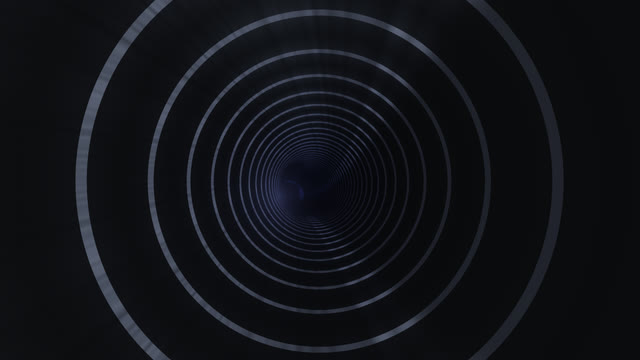

*An endless flight carried by the beat.*

| Section | Control | Range / options | Default |
|---|---|---|---|
| **Settings** | Walls | Light rings · Wire grid · Light panels · Warp streaks | Light rings |
|  | Shape | Round · Triangle · Square · Pentagon · Hexagon · Octagon | Round |
| **Motion** | Flight speed | 0 – 4 | 1 |
|  | Surge on kicks | 0 – 3 | 1 |
|  | Twist | -3 – 3 | 0.6 |
|  | Roll | -1 – 1 | 0.08 |
|  | Curves | 0 – 2 | 0.8 |
| **Walls** | Ring density | 0.5 – 8 | 3.2 |
|  | Segments around shown when Walls: Wire grid / Light panels / Warp streaks | 4 – 48 | 16 |
|  | Line width | 0.2 – 4 | 1.3 |
|  | Walls follow the spectrum | on / off | on |
|  | Depth fade | 0 – 3 | 1 |
|  | Light at the end | 0 – 2 | 0.6 |
| **Color** | Coloring | By depth · By frequency · By energy | By depth |
|  | Color A | color | `#ff7a3d` |
|  | Color B | color | `#6a5cff` |
|  | Brightness | 0.2 – 3 | 1 |
|  | Glow | 0 – 2 | 0.6 |

## Horizon

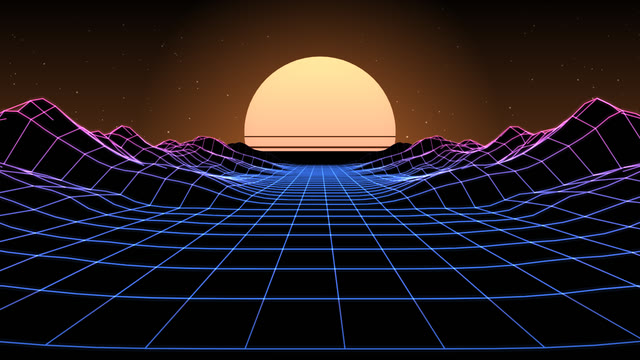

*A landscape grown from the spectrum.*

| Section | Control | Range / options | Default |
|---|---|---|---|
| **Settings** | Landscape | Valley (lows on the sides) · Ridge (lows in the middle) · Lows left, highs right | Valley (lows on the sides) |
|  | Drawing | Rows · Wire grid · Points | Wire grid |
|  | Hide what is behind | on / off | on |
| **Terrain** | Rows | 12 – 90 | 44 |
|  | Detail | 16 – 128 | 64 |
|  | Mountain height | 0.1 – 2.5 | 1 |
|  | Flat road shown when Landscape: Valley (lows on the sides) | 0 – 0.6 | 0.12 |
|  | Smoothing | 0 – 0.95 | 0.45 |
|  | Travel speed | 0.1 – 4 | 1 |
| **View** | Camera height | 0.1 – 1.5 | 0.55 |
|  | Horizon line | 0.15 – 0.75 | 0.42 |
|  | Sky | Nothing · Glow · Setting sun · Moon | Setting sun |
|  | Stars | on / off | on |
| **Color** | Line width | 0.3 – 4 | 1.2 |
|  | Glow | 0 – 2 | 0.8 |
|  | Valleys | color | `#3d7bff` |
|  | Peaks | color | `#ff4fc3` |
|  | Sun and glow | color | `#ff8a3d` |

## Strings

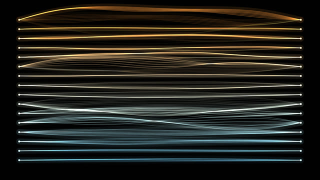

*Plucked by the hits, bowed by the mix.*

| Section | Control | Range / options | Default |
|---|---|---|---|
| **Settings** | Layout | Horizontal · Vertical · Harp · Across a circle | Horizontal |
|  | Strings | 3 – 40 | 14 |
|  | Spread | 0.2 – 1 | 0.78 |
| **Vibration** | Pluck on hits | 0 – 2 | 1 |
|  | Bowed by the level | 0 – 2 | 0.6 |
|  | Amplitude | 0.2 – 3 | 1.4 |
|  | Sustain | 0.1 – 5 s | 1.4 s |
|  | Harmonics | 1 – 8 | 5 |
|  | Vibration speed | 0.1 – 3 | 1 |
|  | Shutter blur | 1 – 12 | 6 |
| **Light** | Line width | 0.3 – 4 | 1.2 |
|  | Glow | 0 – 2 | 1 |
|  | Afterglow | 0 – 0.95 | 0.35 |
|  | Show the ends | on / off | on |
| **Color** | Coloring | Low to high · By energy · Single color | Low to high |
|  | Low strings | color | `#ff9a3d` |
|  | High strings | color | `#7ad7ff` |

## Halo

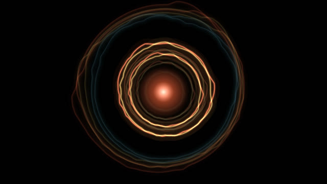

*Every hit throws a ring of light.*

| Section | Control | Range / options | Default |
|---|---|---|---|
| **Settings** | Rings come from | Every hit · Kicks only · A steady pulse · A continuous stream | Every hit |
|  | Rings per second shown when Rings come from: A steady pulse / A continuous stream | 0.5 – 16 | 4 |
|  | Rings per hit shown when Rings come from: Every hit / Kicks only | 1 – 4 | 1 |
| **Shape** | Shape | Circle · Polygon · Star · Flower | Circle |
|  | Points shown when Shape: Polygon / Star / Flower | 3 – 12 | 6 |
|  | Rim follows | The spectrum · The waveform · Nothing | The spectrum |
|  | Rim depth shown when Rim follows: The spectrum / The waveform | 0 – 2 | 0.7 |
|  | Twist per ring | -45 – 45 ° | 6 ° |
| **Motion** | Expansion speed | 0.1 – 3 | 1 |
|  | Ring life | 0.3 – 5 s | 1.8 s |
|  | Reach | 0.3 – 1.6 | 0.95 |
|  | Pulsing core | 0 – 0.4 | 0.1 |
| **Light** | Line width | 0.3 – 6 | 1.4 |
|  | Glow | 0 – 2 | 1 |
|  | Afterglow | 0 – 0.95 | 0.25 |
| **Color** | Coloring | By hit (kick, snare, hat) · By age · Single color | By hit (kick, snare, hat) |
|  | Kick / young | color | `#ff6a3d` |
|  | Snare / old | color | `#ffd36b` |
|  | Hi-hat shown when Coloring: By hit (kick, snare, hat) | color | `#7ad7ff` |

## Cells

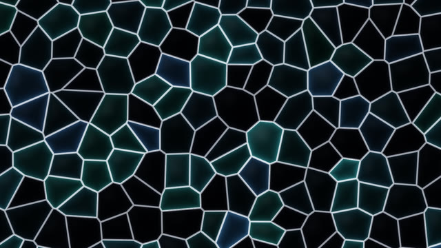

*A living tissue that listens cell by cell.*

| Section | Control | Range / options | Default |
|---|---|---|---|
| **Settings** | Style | Glass · Organic · Crystal · Stained glass | Glass |
|  | Cells follow | A random slice each · Center lows, edge highs · Lows left, highs right | A random slice each |
| **Motion** | Cell count | 2 – 30 | 7 |
|  | Movement range | 0 – 1 | 0.8 |
|  | Movement speed | 0 – 3 | 0.6 |
|  | Flinch on hits | 0 – 2 | 0.8 |
|  | Shrink on builds | on / off | on |
| **Look** | Wall width | 0.1 – 4 | 1 |
|  | Wall glow | 0 – 2 | 1 |
|  | Cell light | 0 – 2 | 1 |
|  | Depth | 0 – 1 | 0.5 |
|  | Brightness | 0.2 – 3 | 1 |
| **Color** | Coloring | By frequency · Two colors · Single color | By frequency |
|  | Color A | color | `#ff4d6d` |
|  | Color B | color | `#4d7cff` |
|  | Wall color | color | `#f2f4ff` |

## Look (every widget)

A post pass over the module's picture.

| Section | Control | Range / options | Default |
|---|---|---|---|
| **Color** | Hue shift | -180 – 180 ° | 0 ° |
|  | Saturation | 0–250 % | 100 % |
|  | Brightness | 0–250 % | 100 % |
|  | Contrast | 20–250 % | 100 % |
|  | Invert | on / off | off |
| **Transform** | Zoom | 20–300 % | 100 % |
|  | Rotation | -180 – 180 ° | 0 ° |
|  | Spin | -90 – 90 °/s | 0 °/s |
|  | Offset X | -1 – 1 | 0 |
|  | Offset Y | -1 – 1 | 0 |
|  | Flip horizontally | on / off | off |
|  | Flip vertically | on / off | off |
| **Symmetry** | Mirror | None · Left ↔ right · Top ↕ bottom · Four quadrants · Kaleidoscope | None |
|  | Kaleidoscope segments shown when Mirror: Kaleidoscope | 3 – 16 | 6 |
| **Effects** | Glow | 0 – 2 | 0 |
|  | Trails | 0–97 % | 0 % |
|  | Pixelate | 0 – 40 | 0 |
|  | Vignette | 0–100 % | 0 % |

## Audio (every widget)

How this widget hears the music. Two widgets can react to the same track differently.

| Section | Control | Range / options | Default |
|---|---|---|---|
| **Response** | Reactivity | 0 – 3 | 1 |
|  | Listen to | Whole mix · Bass and kicks · Mids and vocals · Highs and hats | Whole mix |
|  | Smoothing | 0 – 0.95 | 0 |
|  | Hit strength | 0 – 2.5 | 1 |
| **Time** | Motion speed | 0 – 4 | 1 |
